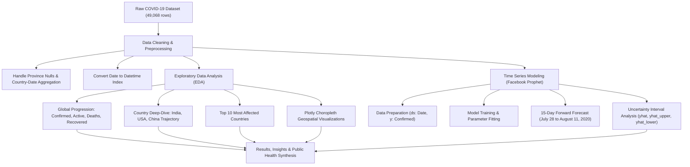

# 🦠 COVID-19 Trend Analysis and Prediction using Python
### *Data Science Capstone Project*


---

## 📌 Executive Summary

**Author:** Ashwin Vishwakarma  
**Domain:** Healthcare Analytics, Epidemiology & Time Series Forecasting  
**Key Tools:** Python, Pandas, NumPy, Matplotlib, Seaborn, Plotly Express, Facebook Prophet  

The novel coronavirus disease (COVID-19) pandemic triggered unprecedented global health, social, and economic disruptions. Tracking the trajectory of confirmed infections, recoveries, active cases, and fatalities is critical for understanding epidemiological patterns, anticipating healthcare infrastructure demands, and evaluating policy interventions.

This capstone project delivers an end-to-end data analytics and time-series forecasting pipeline using historical COVID-19 surveillance data across **187 countries and regions** over a span of **188 consecutive days** (January 22, 2020 to July 27, 2020).

### Key Project Objectives
1. **Trend Analysis:** Track global date-wise evolution of confirmed, active, recovered, and death cases.
2. **Regional & Country Deep Dive:** Evaluate infection and mortality patterns for specific countries (including India, the United States, and China).
3. **Rank & Disparity Assessment:** Identify the top 10 most severely impacted nations across active and mortality metrics.
4. **Interactive Geospatial Visualization:** Map worldwide case distributions using Plotly choropleth visualizations.
5. **Predictive Time-Series Modeling:** Train a Facebook Prophet model to forecast future global confirmed cases over a 15-day forward horizon.

---

## 📊 Dataset Overview

The dataset used in this project is [`covid_19_clean_complete.csv`](file:///c:/Users/Ashwin/OneDrive/Documents/assignments/Capstrone%20covid%2019%20project/covid_19_clean_complete.csv), containing daily country- and province-level epidemiological tracking records.

### Dataset Attributes

| Feature | Data Type | Description |
| :--- | :--- | :--- |
| **`Province/State`** | Object | Sub-national administrative province or state (e.g., Australian states, Chinese provinces). Contains nulls for countries reporting as a single entity. |
| **`Country/Region`** | Object | Sovereign country or territory name (187 distinct countries). |
| **`Lat`** | Float64 | Geographic latitude coordinate of the reporting centroid. |
| **`Long`** | Float64 | Geographic longitude coordinate of the reporting centroid. |
| **`Date`** | Datetime / Object | Observation date (`2020-01-22` to `2020-07-27`, 188 unique dates). |
| **`Confirmed`** | Integer | Cumulative confirmed positive COVID-19 cases. |
| **`Deaths`** | Integer | Cumulative confirmed deaths attributable to COVID-19. |
| **`Recovered`** | Integer | Cumulative recovered patients. |
| **`Active`** | Integer | Active infections calculated as: $\text{Active} = \text{Confirmed} - (\text{Deaths} + \text{Recovered})$. |
| **`WHO Region`** | Object | World Health Organization regional grouping (Americas, Europe, South-East Asia, Eastern Mediterranean, Western Pacific, Africa). |

- **Total Records:** 49,068 rows  
- **Total Features:** 10 columns  
- **Coverage Window:** January 22, 2020 – July 27, 2020  

---

## 🏗️ Project Architecture & Pipeline



---

## 🔍 Key Findings & Exploratory Data Analysis (EDA)

### 1. Data Cleaning & Country-Level Aggregation
- **Province/State Handling:** Certain countries (e.g., Australia, China, Canada, United Kingdom) report data broken down by states or overseas territories, whereas others (e.g., India, Brazil) report at the national level.
- **Aggregation:** Grouped by `Country/Region` and `Date` to consolidate province-level rows into unified national daily observations.
- **Temporal Transformation:** Standardized the `Date` column into pandas `datetime64[ns]` to enable continuous time-series index slicing.

### 2. Country Mortality Comparison: India vs. USA vs. China
Using Seaborn pointplots across the chronological timeline:
- **China (Early Epicenter):** Rapid surge in January–February 2020 followed by strict lockdown containment leading to an early plateau with minimal subsequent mortality growth.
- **United States:** Sustained, steep exponential curve beginning in March 2020, rapidly eclipsing all other countries in cumulative mortality and active case counts.
- **India:** Slower initial ascent through April and May, followed by a persistent accelerating upward trajectory as community transmission expanded across densely populated urban centers.

### 3. Top 10 Countries by Active Case Load
Cumulative active case volume across the dataset window:

| Rank | Country | Cumulative Active Case Count |
| :---: | :--- | :---: |
| 1 | **United States** | **156,981,121** |
| 2 | **Brazil** | **31,094,060** |
| 3 | **United Kingdom** | **22,624,595** |
| 4 | **Russia** | **19,668,578** |
| 5 | **India** | **15,987,913** |
| 6 | **France** | **10,980,287** |
| 7 | **Spain** | **9,277,432** |
| 8 | **Canada** | **8,656,985** |
| 9 | **Peru** | **7,748,957** |
| 10 | **Italy** | **7,363,518** |

### 4. Interactive Geospatial Choropleth Mapping
Interactive global choropleths created via Plotly Express (`px.choropleth`) mapped the geographical distribution of:
- Global **Active Cases** by sovereign boundary
- Global **Confirmed Inundation**
- Regional concentration across WHO administrative regions (Americas and Europe carrying the bulk of active infections during this observation window).

---

## 📈 Time Series Forecasting with Facebook Prophet

Facebook Prophet is an additive regression model designed for time series featuring strong non-linear trends, seasonality, and changepoints.

### Model Formulation
$$\hat{y}(t) = g(t) + s(t) + h(t) + \epsilon_t$$
- $g(t)$: Piecewise linear / logistic trend representing non-periodic changes.
- $s(t)$: Periodic changes (weekly seasonality in reporting).
- $h(t)$: Holiday effects.
- $\epsilon_t$: Error term modeled with normal distribution.

### Implementation Workflow
1. **Target Feature:** Aggregated global daily confirmed cases.
2. **Column Mapping:** Converted into Prophet's standard input schema:
   - `ds`: Date timestamp (`2020-01-22` through `2020-07-27`).
   - `y`: Cumulative global confirmed positive cases.
3. **Training:** Fit `Prophet()` on the 188 historical observations.
4. **Future Generation:** Generated a 15-day extension dataframe (`make_future_dataframe(periods=15)`) extending forecasting through **August 11, 2020**.

### Forecast Results

| Date (`ds`) | Projected Cases (`yhat`) | Lower Bound (`yhat_lower`) | Upper Bound (`yhat_upper`) |
| :--- | :---: | :---: | :---: |
| **2020-07-27 (Observed End)** | **16,131,770** | 16,022,410 | 16,228,880 |
| **2020-07-31** | **16,960,250** | 16,851,580 | 17,066,300 |
| **2020-08-04** | **17,749,490** | 17,627,620 | 17,875,870 |
| **2020-08-08** | **18,596,260** | 18,451,910 | 18,741,780 |
| **2020-08-11 (+15 Days)** | **19,177,830** | **19,006,860** | **19,354,440** |

### Forecasting Takeaways
- The global confirmed trajectory maintained a steep, near-linear expansion through late July and early August 2020.
- Daily incremental additions averaged ~200,000 to 220,000 cases globally during the forecast window.
- The Prophet model captured noticeable weekly seasonality, with minor reporting dips on weekends followed by catch-up reporting spikes on weekdays.

---

## 📁 Repository Structure

```
.
├── COVID-19 Trend Analysis (1).ipynb   # Complete Jupyter Notebook with code, plots & model
├── covid_19_clean_complete.csv          # Cleaned global COVID-19 dataset (188 days)
├── requirements.txt                    # Project dependencies
├── .gitignore                          # Git ignore rules for Python & Jupyter
└── README.md                           # Comprehensive project documentation
```

---

## 🚀 Installation & Usage Guide

### Prerequisites
- Python 3.9 or higher
- Jupyter Notebook or JupyterLab

### 1. Clone the Repository
```bash
git clone https://github.com/ashwin0657/Covid-19-Project-.git
cd Covid-19-Project-
```

### 2. Create and Activate a Virtual Environment
```bash
# On Windows
python -m venv venv
venv\Scripts\activate

# On macOS/Linux
python3 -m venv venv
source venv/bin/activate
```

### 3. Install Dependencies
```bash
pip install -r requirements.txt
```

### 4. Launch Jupyter Notebook
```bash
jupyter notebook "COVID-19 Trend Analysis (1).ipynb"
```

---

## 💡 Results & Public Health Insights

1. **Infection Dynamics:** The pandemic exhibited rapid exponential growth in early 2020 before entering a sustained global expansion phase driven by multiple concurrent regional waves.
2. **Healthcare Capacity Planning:** Short-term time-series forecasts provide critical 1- to 2-week early warning signals for hospital ICU capacity, oxygen demand, and frontline healthcare staffing.
3. **Recovery Improvements:** Global recovery rates increased progressively as clinical management protocols, therapeutic interventions, and early testing capabilities matured.

---

## 👤 Author

- **Ashwin Vishwakarma**  
- GitHub: [@ashwin0657](https://github.com/ashwin0657)  
- Project Repository: [Covid-19-Project-](https://github.com/ashwin0657/Covid-19-Project-.git)
